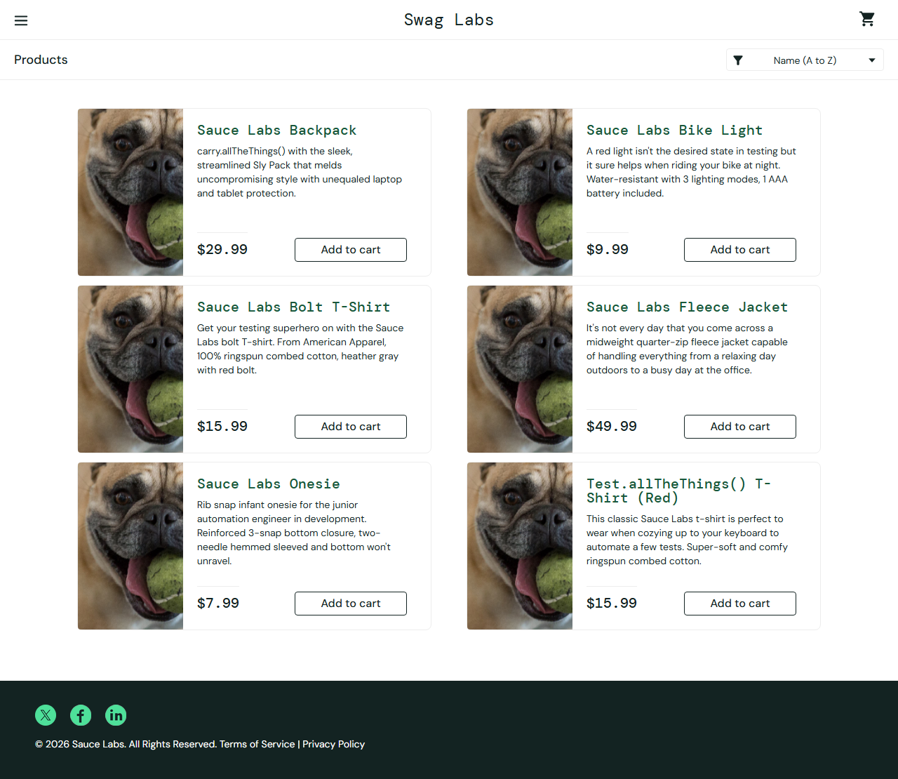

# BUG-001 · La ordenación por precio no funciona con problem_user

**Estado:** reproducido en la tienda de práctica el 7 de noviembre de 2026.
**Tipo:** defecto funcional observable en una cuenta problemática de demostración.
**Severidad propuesta:** media. Impide comparar por precio, pero no bloquea el acceso.
**Prioridad propuesta:** media en un producto real; aquí es evidencia de práctica.
No se ha enviado una incidencia al proveedor ni se atribuye un hallazgo inédito.

## Entorno y precondiciones

- URL: `https://www.saucedemo.com/`.
- Navegador: Chromium instalado por Playwright 1.65.0 en Windows.
- Sesión nueva con `problem_user` y la contraseña pública mostrada por la demo.
- Catálogo visible y seis productos en un orden inicial no ascendente por precio.

## Pasos

1. Abrir la tienda e iniciar sesión con `problem_user`.
2. Guardar los precios visibles antes de ordenar.
3. Elegir **Price (low to high)**.
4. Comparar el orden resultante con la ordenación numérica ascendente.

## Resultado esperado

Precios: **7.99, 9.99, 15.99, 15.99, 29.99, 49.99**.
Se conserva la misma colección de precios, en orden ascendente.

## Resultado observado

Los precios permanecen en su orden inicial:
**29.99, 9.99, 15.99, 49.99, 7.99, 15.99**.
El selector vuelve a mostrar «Name (A to Z)» después de intentar ordenar por precio.
La comparación falla tras esperar el estado esperado con Playwright.

La prueba guarda captura y un adjunto JSON con `before`, `expected` y `actual`
en centavos. El informe incluye traza y vídeo del fallo.

## Reproducción automática

```sh
npm run test:known-defect
```

Debe ejecutar **un caso** y terminar con código **1** por diferencia de precios.
El fallo no se silencia con `test.fail()`, `skip` ni una aserción debilitada. El
evento de diálogo se descarta para que la prueba pueda inspeccionar el catálogo;
el criterio de éxito sigue siendo la ordenación de precios.

Si el caso deja de fallar, revisar la evidencia: puede significar que se corrigió
la demo o cambió su comportamiento. Un error de red, acceso o arranque no confirma
este defecto.

## Evidencia



[Precios registrados por la prueba, en centavos](evidence/bug-001-prices.json).
La suite principal comprueba la misma ordenación con `standard_user` y permite
comparar ambos comportamientos.
