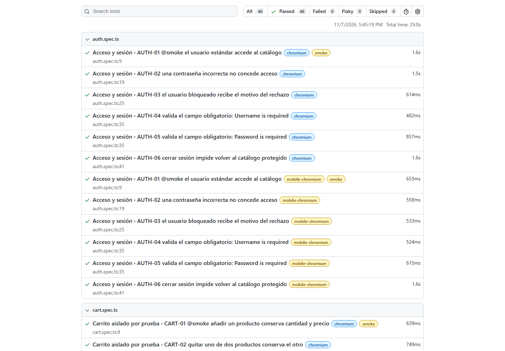

# Resultados ejecutados

Fecha de referencia: **7 de noviembre de 2026**.

## Regresión principal en Windows

| Perfil                 |  Casos | Resultado                                                 |
| ---------------------- | -----: | --------------------------------------------------------- |
| Chromium escritorio    |     23 | 23 correctos                                              |
| Chromium móvil emulado |     23 | 23 correctos                                              |
| **Total**              | **46** | **46 correctos, 0 fallidos, 0 omitidos, 0 intermitentes** |

La ejecución final se realizó con `npm test`, sin reintentos locales, Node.js 24.15.0
y Playwright 1.65.0. Duró aproximadamente 30 segundos. TypeScript, Prettier y la
revisión de dependencias también terminaron correctamente; `npm audit` no informó
vulnerabilidades conocidas en esa revisión.

Resumen por caso y perfil: [`evidence/local-execution.json`](evidence/local-execution.json).
El resumen excluye rutas privadas, cookies y registros brutos.

## Firefox: comprobación adicional

La primera exploración incluyó Firefox y produjo 23 errores de infraestructura:
`browserType.launch: spawn UNKNOWN`, antes de interactuar con la aplicación.
No se presentan como defectos de SauceDemo ni como pruebas funcionales superadas.

Se conserva la [evidencia de esa comprobación inicial](evidence/initial-browser-check.json).
Firefox se ofrece en una configuración separada mediante `npm run test:firefox`;
no forma parte del comando principal de regresión ni de su cifra de aprobados.

## GitHub Actions

El flujo está publicado y configura la regresión de escritorio y móvil en Linux.
La [primera ejecución](https://github.com/SantiagoAtehortuaSoto/qa-automation-playwright/actions/runs/42421943988)
fue bloqueada antes de iniciar por una restricción de cuenta; no recibió runner
y no ejecutó ningún paso. Se diferencia este bloqueo de un fallo de pruebas.

El flujo queda preparado para futuras ejecuciones, pero **no está validado en CI**.
Consultar el [historial](https://github.com/SantiagoAtehortuaSoto/qa-automation-playwright/actions/workflows/qa.yml).

## Defecto reproducido

BUG-001 se ejecutó por separado: un caso, un fallo por diferencia real de precios,
sin `skip`, reintentos ni `test.fail()`. Se conservaron captura, traza, vídeo y los
valores esperados y observados. No se suma a la regresión principal.
Ver [el informe y la evidencia](bug-report.md).

## Límites

Los resultados describen esta ejecución en una aplicación externa. No constituyen
una certificación de calidad global, seguridad o rendimiento, ni cubren dispositivos
móviles físicos. La disponibilidad y los datos de la demo pueden cambiar.
